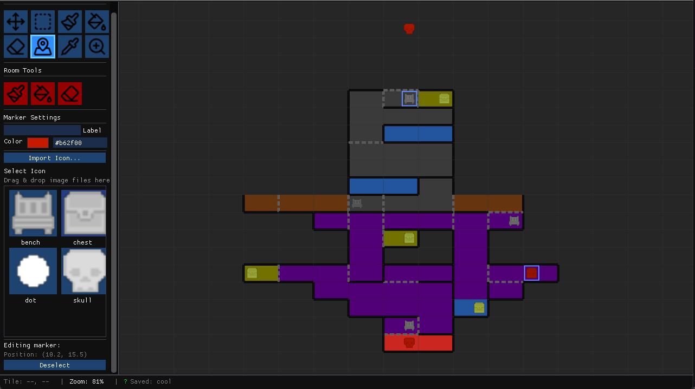

# Cartograph

A lightweight cross-platform tool for designing Metroidvania-style maps.

[](https://unveil-gg.itch.io/Cartograph)

[](https://discord.gg/gaZ5XuPhz)



## Features

Design interconnected game worlds with an intuitive canvas:

**Canvas & Editing**
- Infinite pan/zoom canvas with grid snapping
- Multiple tools: Paint, Erase, Fill, Eyedropper, Marker, Zoom
- Selection tool with copy/paste, cut, move, and nudge
- Walls and doors on cell edges
- Full undo/redo history

**Organization**
- Rooms with custom colors and metadata
- Markers for items, saves, bosses with custom icons
- Region groups for organizing areas

**Export & Themes**
- PNG export with configurable layers and scale
- Dark and Print-Light themes
- Autosave with crash recovery

**Cross-Platform**
- Native apps for macOS and Windows
- `.cart` files (ZIP containers with JSON project data)

## Quick Start

**Prerequisites:**
- macOS 10.15+ or Windows 10+
- Git
- CMake 3.16+
- C++17 compiler

### macOS

Dependencies live in `third_party/` (not git submodules). See [BUILDING.md](BUILDING.md) if a dependency is missing.

```bash
git clone https://github.com/unveil-gg/cartograph.git
cd cartograph
mkdir build && cd build
cmake -DCMAKE_BUILD_TYPE=Release .. && make
./Cartograph.app/Contents/MacOS/Cartograph
```

### Windows
Use the Visual Studio generator that matches your install. CI uses Visual Studio 2022. If CMake reports a generator mismatch, delete the build directory and reconfigure.
```bash
git clone https://github.com/unveil-gg/cartograph.git
cd cartograph
mkdir build
cd build
cmake -G "Visual Studio 17 2022" -A x64 ..
cmake --build . --config Release
.\Release\Cartograph.exe
```

A WebAssembly build for the browser is also supported; see the Web section of [BUILDING.md](BUILDING.md).

See [BUILDING.md](BUILDING.md) for detailed build instructions, options, and distribution setup.

## Keyboard Shortcuts

### Tools

| Shortcut | Action |
|----------|--------|
| V | Move tool (pan canvas) |
| S | Select tool |
| B | Paint brush |
| E | Erase tool |
| F | Fill tool |
| I | Eyedropper |
| M | Marker tool |
| Z | Zoom tool |

### Selection (when Select tool active)

| Shortcut | Action |
|----------|--------|
| Ctrl/Cmd+A | Select all |
| Ctrl/Cmd+C | Copy selection |
| Ctrl/Cmd+X | Cut selection |
| Ctrl/Cmd+V | Paste |
| Delete/Backspace | Delete selection |
| Arrow keys | Nudge selection |
| Escape | Deselect / Cancel paste |

### View

| Shortcut | Action |
|----------|--------|
| Space+Drag | Pan canvas |
| Mouse Wheel | Zoom in/out |
| G | Toggle grid |
| O | Toggle room overlays |
| = / - | Zoom in/out |

### File

| Shortcut | Action |
|----------|--------|
| Ctrl/Cmd+N | New project |
| Ctrl/Cmd+O | Open project |
| Ctrl/Cmd+S | Save |
| Ctrl/Cmd+Shift+S | Save As |
| Ctrl/Cmd+E | Export PNG |
| Ctrl/Cmd+Z | Undo |
| Ctrl/Cmd+Shift+Z (or Ctrl+Y) | Redo |

## File Format

Projects are saved as `.cart` files — ZIP archives containing:
- `manifest.json` — Package kind, version, and title
- `project.json` — Project data, rooms, tiles, markers, settings (schema version 3, see docs/format.md)
- `icons/` — Custom marker icons (PNG)
- `thumb.png` — Optional preview

Folder projects (`.cartproj`) store the same `project.json` plus `icons/` and `preview.png`. The extension check for `.cart` ignores case.

## Use with a game generator

Maps can carry ability gates, one-way doors, door spawns, room and region
properties, typed markers and a per-cell interior tile layer. The headless
`cartograph-cli` (built next to the app) turns a map into plain JSON and
checks that the gates are beatable:

```bash
cartograph-cli export map.cart -o map.json
cartograph-cli validate map.cart --order dash,double-jump
```

The schema, conventions and a small sample map are in
[docs/format.md](docs/format.md) and [docs/sample-map.json](docs/sample-map.json).

## Contributing

We welcome contributions! Please read [CONTRIBUTORS.md](CONTRIBUTORS.md) for guidelines.

## License

MIT License - see [LICENSE](LICENSE) for details.

Third-party dependencies have their own licenses - see [THIRD_PARTY_NOTICES.md](THIRD_PARTY_NOTICES.md).

## Credits

Built with [SDL3](https://github.com/libsdl-org/SDL), [Dear ImGui](https://github.com/ocornut/imgui), and other open source libraries. Icons from [Lucide](https://lucide.dev) (ISC License).
